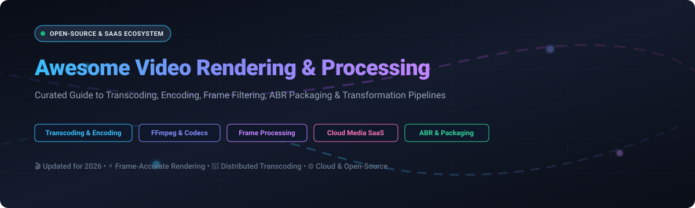

# 🎬 Awesome Video Rendering & Processing

  

  
  
  
  
  

---

## 🚀 Top Video Rendering & Processing Ecosystem

**Curated List of SaaS Products & Open-Source GitHub Projects for Video Engineers, DevOps & Media Architects**  
*Focused on Transcoding, Encoding, Frame Filtering, ABR Packaging, Hardware Acceleration & Media Transformation Pipelines*  

📅 **Last updated:** October 2026

---

### 💡 Overview & SEO Keywords

This repository tracks notable **SaaS platforms** and **open-source projects** for **Video Rendering & Processing**. In modern media delivery, video rendering and processing systems convert, transcode, filter, composite, and package media assets—from raw camera ingest and timeline editing to cloud media factories, high-throughput microservices, and distributed GPU clusters.

Key architectural concepts and search keywords covered include:
- **Cloud Video Transcoding & Encoding**: Scalable file-to-file and live stream transcoding, multi-bitrate ladder generation, perceptual quality tuning (VMAF, PSNR, SSIM).
- **Core Codec Standards**: AV1 (libsvtav1), HEVC / H.265 (libx265), AVC / H.264 (libx264), VP9 (libvpx), and next-generation codecs (VVC / H.266).
- **Adaptive Bitrate (ABR) Packaging**: Segmenting and manifest creation for HLS (`.m3u8`), MPEG-DASH (`.mpd`), and CMAF (Common Media Application Format) with DRM signaling.
- **Hardware Acceleration**: GPU-accelerated transcoding pipelines utilizing NVIDIA NVENC/NVDEC, Intel QuickSync Video (QSV), AMD AMF, and Linux VA-API.
- **Frame-Level Processing & Scripting**: Frame restoration, deinterlacing, color correction, timeline compositing, and programmatic automation via Python and Node.js.

---

## 📋 Table of Contents

- [📊 Sector Overview & Market Dynamics](#-sector-overview--market-dynamics)
- [☁️ SaaS/Hosted Platforms](#️-saashosted-platforms)
- [🔓 Open-Source GitHub Projects](#-open-source-github-projects)
- [🏗️ Architectural Guidelines & Pipelines](#️-architectural-guidelines--pipelines)
- [🤝 How to Contribute](#-how-to-contribute)
- [💖 Support & Community](#-support--community)
- [⚠️ Disclaimer](#️-disclaimer)
- [⭐ Star History](#-star-history)

---

## 📊 Sector Overview & Market Dynamics

> 📈 **Estimated Market Size & Sector Structure:** The global video transcoding, rendering, and processing market is estimated at **~$10.8 Billion** (projected to exceed **~$22.4 Billion by 2032**, growing at a CAGR of ~14.8%). The sector exhibits a **moderately fragmented** structure: cloud hyperscalers (AWS Elemental, Google Cloud Video Intelligence, Azure Media) provide foundational, commodity compute pipelines, while specialized video SaaS providers (Cloudinary, Bitmovin, Mux, Telestream, Wowza) capture high-margin enterprise workloads through specialized developer APIs, perceptual quality optimization (per-title encoding), and complex multi-device delivery workflows.

---

## ☁️ SaaS/Hosted Platforms

| Platform / Service | Company Size (Valuation / Revenue) ↓ | Pricing (Starting Tier) | Free Tier / Free Trial Limit | Key Focus & Capabilities |
| :--- | :--- | :--- | :--- | :--- |
| **[AWS Elemental MediaConvert](https://aws.amazon.com/mediaconvert/)** | **~$2.2 Trillion** Market Cap (AWS Revenue **~$105 Billion**/yr) | **$0.0075/min** (Basic SD/HD AVC), **$0.0150/min** (Professional HD) | **12-Month AWS Free Tier**: **20 minutes/month** of basic tier transcoding | Enterprise broadcast-grade file-to-file cloud video transcoder. Supports advanced audio processing, Dolby Vision HDR, ABR packaging, and automated per-title encoding. |
| **[Adobe Media Encoder](https://www.adobe.com/products/media-encoder.html)** | **~$220 Billion** Market Cap (Annual Revenue **~$21.5 Billion**) | **$22.99/month** (Premiere Pro bundle) or **$59.99/month** (Creative Cloud All Apps) | **7-day free trial** with complete access to all export codecs, GPU acceleration, and render queues | Desktop and creative pipeline render engine. Seamlessly automates ingest, preset-based rendering, color management, and batch export for production houses and broadcast creatives. |
| **[Cloudinary](https://cloudinary.com/)** | **~$2.0 Billion** Valuation (Annual Recurring Revenue **~$150 Million+**) | **$89.00/month** (Plus plan, 225 credits / 225 GB bandwidth/storage) | **Free Forever plan**: **25 monthly credits** (covers ~25,000 video transformations or 25 GB bandwidth) | End-to-end cloud media API. Features dynamic AI-based video cropping, automatic format selection (f_auto), quality optimization (q_auto), and responsive video delivery. |
| **[Fastly Video Optimizer](https://www.fastly.com/products/media-and-streaming)** | **~$1.1 Billion** Market Cap (Annual Revenue **~$530 Million**) | **$50.00/month** minimum spend (**$0.12/GB** bandwidth + **$0.0075/10k requests**) | **$50 one-time credit** developer trial across edge compute and delivery network | Real-time edge media optimization and dynamic transcoding shield. Converts and packages streams on-the-fly directly at edge PoPs for reduced origin latency. |
| **[Vimeo OTT & Video Processing](https://vimeo.com/)** | **~$950 Million** Market Cap (Annual Revenue **~$420 Million**) | **$12.00/seat/month** (Starter tier billed annually, up to 60 videos/yr) | **Free plan**: Up to 3 videos total (up to 500 MB upload/week, 1 GB storage); or **30-day free trial** on paid plans | Comprehensive video hosting, transcoding, and monetization platform with automated adaptive streaming and creator toolkits. |
| **[Mux Video](https://www.mux.com/)** | **~$450 Million** Valuation (Series D, Annual Recurring Revenue **~$50 Million+**) | **$0.005/minute** encoding (Basic) / **$0.016/minute** (High-quality), **$0.0013/minute** streaming | **$100 one-time free credit** upon signup (covers ~20,000 encoding/streaming minutes, no CC required) | Developer-first API for on-demand video and live streaming. Auto-generates instant HLS/DASH playback URLs, animated thumbnails, and automated subtitles without manual pipeline tuning. |
| **[Telestream Cloud](https://cloud.telestream.net/)** | **~$400 Million** Valuation (Backed by Genstar Capital, ARR **~$120 Million**) | **$0.015/output minute** (SD) and **$0.030/output minute** (HD), or monthly plans from **$25.00/month** | **30-day free trial** with **$50 free transcoding credit** (approx. 2,000 free output minutes) | Broadcast-grade cloud media processing service built on Vantage technology. Handles multi-screen packaging, IMF/QC analysis, closed captions, and HDR tone mapping. |
| **[Wowza Video](https://www.wowza.com/)** | **~$250 Million** Valuation (Backed by Clearhaven Partners, ARR **~$60 Million**) | **$99.00/month** (Pay As You Go with $99 prepaid credit; $0.15/transcoding hour) | **30-day free trial** (includes 1,000 free viewing minutes, 5 streaming hours, and transcoding API sandbox) | Integrated cloud streaming platform for live and VOD workflows. Offers live transcoding from RTMP/SRT/WebRTC to HLS/DASH with customizable player embeds. |
| **[Bitmovin Video Encoding](https://bitmovin.com/)** | **~$200 Million** Valuation (Series C, Annual Recurring Revenue **~$30 Million**) | **$0.015/minute** (VOD standard encoding) and **$0.050/minute** (Live encoding), pay-as-you-go | **30-day free trial** with **2,000 free VOD encoding minutes** and 360 live encoding minutes per month | High-performance multi-cloud encoding API with massively distributed chunked processing (100x real-time), 3-pass encoding, AV1 support, and per-title optimization algorithms. |
| **[Coconut Video Transcoding](https://coconut.co/)** | **~$20 Million** Valuation (Independent profitable media SaaS) | **$0.005/output minute** (Standard package starting at **$15.00/month** for 3,000 minutes) | **14-day free trial** with **1,000 free transcoding output minutes** | Lightweight, developer-friendly video transcoding API. Simplifies video conversion into MP4, WebM, HLS, and thumbnails with simple Webhook notifications. |

---

## 🔓 Open-Source GitHub Projects

*Sorted by GitHub Stars Count (Descending)* ⭐

- **[OpenCV](https://github.com/opencv/opencv)**   
  **Open Source Computer Vision Library**, Apache-2.0 licensed. Industry-standard library for real-time computer vision, video frame manipulation, filtering, motion analysis, and hardware-accelerated image pipelines. **Best for frame-level computer vision and processing**.

- **[OBS Studio](https://github.com/obsproject/obs-studio)**   
  **Free and open-source software for video recording and live streaming**, GPL-2.0 licensed. High-performance real-time video/audio capturing, scene compositing, hardware encoding (NVENC, QSV, AMF), and live production switching. **Best for live video compositing and capture**.

- **[FFmpeg](https://github.com/FFmpeg/FFmpeg)**   
  **The foundational open multimedia framework**, LGPL/GPL licensed. Universal CLI and C libraries (`libavcodec`, `libavformat`, `libavfilter`) to decode, encode, transcode, mux, demux, stream, filter, and play virtually any media format. **Best for core video processing and transcoding pipelines**.

- **[Remotion](https://github.com/remotion-dev/remotion)**   
  **Make videos programmatically using React**, Custom Multi-license. Renders frame-accurate videos using web technologies (HTML, CSS, Canvas, WebGL, React) with server-side and serverless rendering on AWS Lambda. **Best for programmatic and data-driven video generation**.

- **[LosslessCut](https://github.com/mifi/lossless-cut)**   
  **The Swiss Army knife of lossless video/audio editing**, GPL-2.0 licensed. Ultra-fast direct stream copy trimming, cutting, merging, and track extraction without re-encoding quality degradation. **Best for fast lossless trimming and slicing**.

- **[HandBrake](https://github.com/HandBrake/HandBrake)**   
  **Open-source video transcoder**, GPL-2.0 licensed. User-friendly desktop application and CLI tool with curated hardware/software presets, batch queuing, subtitles, and chapter markers. **Best for desktop batch conversion and personal transcoding**.

- **[Blender](https://github.com/blender/blender)**   
  **Free and open 3D creation suite**, GPL-3.0 licensed. Includes a capable Video Sequence Editor (VSE) and node-based compositor for multi-track video editing, color grading, masking, and timeline rendering. **Best for 3D integration, VFX compositing, and sequence editing**.

- **[Shotcut](https://github.com/mltframework/shotcut)**   
  **Free, open-source, cross-platform video editor**, GPL-3.0 licensed. Built on the MLT Multimedia Framework with native timeline editing, multi-format 4K rendering, hardware encoding, and rich video filters. **Best for cross-platform desktop video editing**.

- **[MoviePy](https://github.com/Zulko/moviepy)**   
  **Python module for script-based video editing**, MIT licensed. Programmatic cuts, concatenations, title insertions, animated GIFs, and custom audio/video transformations powered by NumPy and FFmpeg. **Best for Python automated video generation and scripting**.

- **[Olive](https://github.com/olive-editor/olive)**   
  **Fast, non-linear video editing software**, GPL-3.0 licensed. Node-based compositing workflow designed to provide a modern, high-performance alternative to proprietary NLEs with real-time playback. **Best for node-based non-linear video editing**.

- **[OpenShot Video Editor](https://github.com/OpenShot/openshot-qt)**   
  **Award-winning open-source video editor**, GPL-3.0 licensed. Built on C++ (`libopenshot`) and Python/Qt with unlimited timeline tracks, 3D animated titles, curve-based keyframe animations, and multi-format rendering. **Best for beginner-friendly desktop video editing**.

- **[OpenH264](https://github.com/cisco/openh264)**   
  **Open source H.264 codec library by Cisco**, BSD-2-Clause licensed. High-performance, patent-cleared H.264/AVC encoder and decoder designed for real-time video communication and WebRTC pipelines. **Best for real-time video communications and browser codecs**.

- **[Kdenlive](https://github.com/KDE/kdenlive)**   
  **Powerful open-source non-linear video editor from KDE**, GPL-3.0 licensed. Multi-track timeline, keyframeable effects, color correction, proxy clips, audio mixing, and high-performance FFmpeg rendering output. **Best for advanced Linux and cross-platform video editing**.

- **[Natron](https://github.com/NatronGitHub/Natron)**   
  **Node-based digital compositor for visual effects**, GPL-2.0 licensed. OpenFX plugin-compatible node graph architecture providing professional 2D/2.5D VFX compositing, rotoscoping, keying, and tracking. **Best for node-based visual effects and multi-layer compositing**.

- **[GStreamer](https://github.com/GStreamer/gstreamer)**   
  **Modular pipeline-based multimedia framework**, LGPL-2.1 licensed. Assembles complex arbitrary pipelines of video sources, decoders, filters, compositors, encoders, and sinks across embedded, mobile, and server environments. **Best for complex, long-running real-time processing pipelines**.

- **[Shaka Packager](https://github.com/shaka-project/shaka-packager)**   
  **Media packaging and encryption SDK from Google**, Apache-2.0 licensed. Packages media into DASH, HLS, and CMAF with Multi-DRM encryption (Widevine, FairPlay, PlayReady), dynamic ad markers, and live stream segmenting. **Best for DRM packaging and ABR manifest generation**.

- **[VapourSynth](https://github.com/vapoursynth/vapoursynth)**   
  **Modern video processing and filtering application with Python scripting**, LGPL-2.1 licensed. Successor to AviSynth offering multithreaded per-frame manipulation, deep-learning super-resolution filters, and scriptable color pipeline control. **Best for frame-accurate video restoration and pre-encoding filtering**.

- **[MLT Multimedia Framework](https://github.com/mltframework/mlt)**   
  **Open-source multimedia authoring framework for television broadcasting**, LGPL-2.1 licensed. Powers Shotcut and Kdenlive with multi-track composition, audio mixers, transition filters, and flexible timeline rendering services. **Best for building custom video editors and broadcast playout**.

- **[AviSynth+](https://github.com/AviSynth/AviSynthPlus)**   
  **Advanced script-driven frame server and video post-production tool**, GPL-2.0 licensed. High-performance non-linear video editing scripting tool for deinterlacing, denoising, sharpening, and color grading without intermediate file writes. **Best for classic scriptable frame filtering and remastering**.

- **[libvpx](https://github.com/webmproject/libvpx)**   
  **VP8 and VP9 video codec reference implementation from Google**, BSD-3-Clause licensed. Reference software encoder and decoder library for high-efficiency WebM video streaming and browser-native playback. **Best for VP8/VP9 web streaming codecs**.

- **[Kvazaar](https://github.com/ultravideo/kvazaar)**   
  **Modular and ultra-fast HEVC/H.265 software video encoder**, BSD-3-Clause licensed. Optimized with AVX-512 and multi-threading for real-time 4K/8K HEVC encoding on standard x86 and ARM server CPUs. **Best for high-efficiency x86/ARM HEVC software encoding**.

---

## 🏗️ Architectural Guidelines & Pipelines

Building a scalable, production-ready video rendering and processing infrastructure typically follows a tiered architectural model:

1. **Ingest & Extraction:**
   - Ingest source files (ProRes, DNxHD, RAW, MP4) via Amazon S3, MinIO, or direct SFTP.
   - Run probe analysis (`ffprobe`) to extract container metadata, color primaries, HDR transfer characteristics, and audio channel configurations.
2. **Preprocessing & Filtering:**
   - Deinterlace and crop using **FFmpeg** (`bwdif`, `cropdetect`) or **VapourSynth** for advanced denoising and temporal restoration.
   - Apply frame-rate conversion and color conversions (BT.709 ↔ BT.2020) using hardware-accelerated shaders or OpenCL filters.
3. **Chunked Distributed Transcoding:**
   - Split mezzanine video at GOP (Group of Pictures) / keyframe boundaries.
   - Distribute chunks across serverless workers (AWS Lambda / ECS) or spot GPU instances using **FFmpeg** or **Bitmovin** chunked engines for 10x-100x real-time speed.
   - Encode multiple resolutions and bitrates (1080p, 720p, 480p, 360p) into target codecs (AV1, HEVC, H.264).
4. **Packaging & Manifest Generation:**
   - Feed elementary streams into **Shaka Packager** or **GPAC MP4Box** to generate fragmented MP4 (fMP4) chunks.
   - Output adaptive manifests for HLS (`master.m3u8`) and MPEG-DASH (`manifest.mpd`) with Common Encryption (CENC).
5. **Origin Caching & CDN Delivery:**
   - Shield packaging nodes behind **Nginx** or **Caddy** origin caches with byte-range caching enabled.
   - Distribute globally via tier-1 CDNs (Cloudflare, CloudFront, Fastly) for low-latency playback.

---

## 🤝 How to Contribute

Contributions are warmly welcome! To contribute a new SaaS platform, open-source project, or architectural guideline:

1. 🔀 **Fork the repository**.
2. 📝 **Add your tool** under the appropriate section adhering to the established schema:
   - For SaaS: Include company size / valuation, specific starting price, specific free tier limits, and core features.
   - For Open-Source: Include the stargazer count badge ``, license, and "Best for" use-case. Maintain descending star order.
3. 🚀 **Submit a Pull Request (PR)** with a descriptive title and rationale.

Check out [Awesome Lists](https://github.com/ishandutta2007/Awesome-Awesome-Awesome) for wider community guidelines!

---

## 💖 Support & Community

Thank you for exploring **Awesome Video Rendering & Processing**! If you find this curated ecosystem helpful for your video architecture, encoding pipelines, or multimedia projects:

- 🌟 **Star this repository** to help fellow engineers discover it.
- 🔀 **Fork and share** with colleagues, dev teams, and streaming architects.
- ☕ **Sponsor the project** or buy a coffee to support continuous updates and active curation:

  

---

## ⚠️ Disclaimer

- This is a **community-curated list** created strictly for educational, technical, and architectural reference.
- Video encoding and transcoding can require significant CPU/GPU compute and may involve patented codec intellectual property (e.g. AVC, HEVC, VVC). Verify licensing requirements for commercial deployments.
- Quality evaluations should always be validated empirically using objective metrics (e.g., Netflix VMAF, PSNR, SSIM) across representative production video assets.

---

## ⭐ Star History

---

  <b>Made with ❤️ for video engineers, platform teams, and streaming architects.</b>

